# Sweep Analysis Report

_Generated 2026-07-21 14:06 · config `analyze_sweep.json` · results `results` · 4 datasets_

> Throughput/latency tables use the **trimmed** mean (drop best+worst run). The **Stability** block under each dataset reports the raw untrimmed distribution so high-variance / election-storm runs stay visible.

## Baseline (fault-free)

_fault=baseline, 3 groups — runs 1..20 (20 selected)_

### Throughput & latency (trimmed mean)

#### Baseline (fault-free) | MIXED — READ (trimmed mean ±std)

```text
Group                             n          QPS                p50            p95            p99           p99.9        ok%  
------------------------------  ---  --------------------  -------------  -------------  -------------  -------------  -------
raft                             18     16,546 ±1,096       32.84 ±2.09    57.41 ±3.23    70.34 ±3.83    98.69 ±9.56   100.00 
netelect-raft                    18      16,497 ±643        32.99 ±1.18    56.95 ±1.88    69.49 ±2.22    94.72 ±5.32   100.00 
netelect-jacobson                18       16,320 ±80        33.29 ±0.19    57.60 ±0.33    70.14 ±0.70    97.62 ±6.52   100.00 
```

#### Baseline (fault-free) | MIXED — WRITE (trimmed mean ±std)

```text
Group                             n          QPS                p50            p95            p99           p99.9        ok%  
------------------------------  ---  --------------------  -------------  -------------  -------------  -------------  -------
raft                             18       4,137 ±273        17.95 ±1.10    36.19 ±1.94    46.03 ±2.53    68.61 ±5.47   100.00 
netelect-raft                    18       4,127 ±161        17.88 ±0.63    36.02 ±1.19    45.79 ±1.49    67.98 ±4.56   100.00 
netelect-jacobson                18       4,081 ±19         17.99 ±0.16    36.23 ±0.38    46.19 ±0.89    69.55 ±6.86   100.00 
```

#### Baseline (fault-free) | READ — READ (trimmed mean ±std)

```text
Group                             n          QPS                p50            p95            p99           p99.9        ok%  
------------------------------  ---  --------------------  -------------  -------------  -------------  -------------  -------
raft                             18      65,806 ±177        10.12 ±0.08    17.04 ±0.08    21.79 ±0.28    29.97 ±0.50   100.00 
netelect-raft                    18      66,140 ±160        10.02 ±0.05    17.05 ±0.07    21.23 ±0.13    29.43 ±0.36   100.00 
netelect-jacobson                18      65,837 ±324        10.09 ±0.08    17.02 ±0.12    21.76 ±0.47    29.67 ±0.56   100.00 
```

#### Stability — cluster QPS, raw/untrimmed distribution

Trimmed tables above drop the best+worst run; this one keeps every run so high variance / bad-run tails (e.g. election-storm runs) stay visible. CV = std/mean (lower = more stable).

```text
Group                     phase         n       mean      std    CV%        min     median        max
-----------------------------------------------------------------------------------------------------
raft                      mixed-read   20     16,636    1,157    7.0     15,878     16,082     19,010
raft                      mixed-write  20      4,160      288    6.9      3,980      4,028      4,752
raft                      read         20     65,799      186    0.3     65,458     65,882     66,010
netelect-raft             mixed-read   20     16,622      852    5.1     16,218     16,348     19,278
netelect-raft             mixed-write  20      4,156      208    5.0      4,039      4,093      4,787
netelect-raft             read         20     66,148      189    0.3     65,856     66,165     66,590
netelect-jacobson         mixed-read   20     16,453      612    3.7     16,202     16,298     19,098
netelect-jacobson         mixed-write  20      4,115      154    3.8      4,052      4,076      4,783
netelect-jacobson         read         20     65,978      835    1.3     65,165     65,802     69,314
```

### Plots

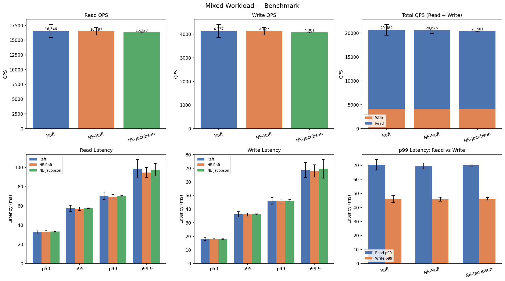
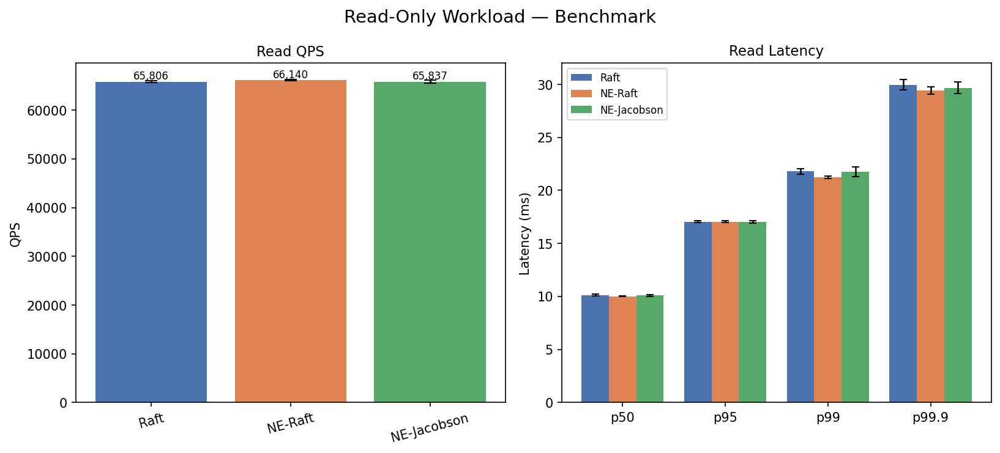

## WAN latency

_fault=wan, 3 groups — runs 53..72 (20 selected)_

### Throughput & latency (trimmed mean)

#### WAN latency | MIXED — READ (trimmed mean ±std)

```text
Group                             n          QPS                p50            p95            p99           p99.9        ok%  
------------------------------  ---  --------------------  -------------  -------------  -------------  -------------  -------
raft-wan                         18       7,500 ±596        73.89 ±6.69    88.31 ±4.80    98.82 ±3.93   125.42 ±9.61   100.00 
netelect-raft-wan                18      10,463 ±643        50.35 ±2.91    76.44 ±3.53    89.11 ±3.50   117.16 ±9.95    99.98 
netelect-jacobson-wan            18      11,715 ±560        45.24 ±2.22    70.01 ±3.10    82.94 ±2.90   110.97 ±4.50   100.00 
```

#### WAN latency | MIXED — WRITE (trimmed mean ±std)

```text
Group                             n          QPS                p50            p95            p99           p99.9        ok%  
------------------------------  ---  --------------------  -------------  -------------  -------------  -------------  -------
raft-wan                         18       1,874 ±147        51.81 ±3.56    66.68 ±3.54    74.05 ±3.11   104.19 ±9.69   100.00 
netelect-raft-wan                18       2,615 ±156        34.67 ±2.14    57.71 ±2.81    70.88 ±3.02    95.92 ±7.47    99.99 
netelect-jacobson-wan            18       2,930 ±136        30.57 ±1.69    52.55 ±2.21    65.20 ±2.42    91.66 ±4.88   100.00 
```

#### WAN latency | READ — READ (trimmed mean ±std)

```text
Group                             n          QPS                p50            p95            p99           p99.9        ok%  
------------------------------  ---  --------------------  -------------  -------------  -------------  -------------  -------
raft-wan                         18        8,273 ±5         77.33 ±0.02    80.54 ±0.23    83.28 ±0.57   111.77 ±7.68   100.00 
netelect-raft-wan                18       19,411 ±68        29.83 ±0.09    43.37 ±0.18    48.00 ±2.28    64.28 ±4.11   100.00 
netelect-jacobson-wan            18      25,409 ±147        23.70 ±0.05    32.45 ±0.61    38.27 ±1.82    47.60 ±2.28   100.00 
```

#### Stability — cluster QPS, raw/untrimmed distribution

Trimmed tables above drop the best+worst run; this one keeps every run so high variance / bad-run tails (e.g. election-storm runs) stay visible. CV = std/mean (lower = more stable).

```text
Group                     phase         n       mean      std    CV%        min     median        max
-----------------------------------------------------------------------------------------------------
raft-wan                  mixed-read   20      7,508      617    8.2      6,692      7,400      8,461
raft-wan                  mixed-write  20      1,876      154    8.2      1,673      1,851      2,126
raft-wan                  read         20      8,273        6    0.1      8,265      8,273      8,282
netelect-raft-wan         mixed-read   20     10,481      682    6.5      9,594     10,269     11,691
netelect-raft-wan         mixed-write  20      2,620      168    6.4      2,389      2,572      2,935
netelect-raft-wan         read         20     19,411       77    0.4     19,261     19,391     19,548
netelect-jacobson-wan     mixed-read   20     11,670      617    5.3     10,286     11,961     12,237
netelect-jacobson-wan     mixed-write  20      2,918      152    5.2      2,562      2,993      3,064
netelect-jacobson-wan     read         20     25,389      191    0.8     24,832     25,476     25,598
```

### Petition / leadership — fault=wan (from mixed-phase server logs)

Column meanings:

- **n** — runs analyzed for this group.
- **migrate%** — share of runs whose *final* leader is a near (non-far) node, i.e. leadership successfully migrated off the slow far leader. 100% = always ended on a fast node.
- **mig_t(s)** — approx benchmark-second at which read QPS rises from the slow-far-leader plateau to the fast-near-leader plateau (read from the per-second timeseries, since petition logs carry no wall-clock). Lower = migration took effect sooner. `n/a` = no clear rise.
- **LE/run** — average `[leader_elected]` events per run = number of leadership changes. Higher = more churn (extra re-elections / split votes).
- **pSend/run** — average `[petition_send]` per run: how many petitions followers sent toward a proposed faster leader.
- **pAcc/run** — average `[petition_accept]` per run: how many petitions a proposed leader accepted (majority petitioned *and* its RTT was no worse) → it then forces the old leader down.
- **nearPetn%** — share of runs in which at least one *near* node sent a petition. Confirms the fast nodes (not just far ones) actually drive the migration.
- **eMsgSent/run · eMsgRecv/run** — average cumulative `Raft.RequestVote` messages sent / received per run (election control-plane traffic). Lower = fewer/cleaner elections.

```text
Group                     n migrate% mig_t(s)  LE/run pSend/run pAcc/run nearPetn% eMsgSent/run eMsgRecv/run
------------------------------------------------------------------------------------------------------------
raft-wan                 20       0%      1.0     1.0         0      0.0        0%            5            4
netelect-raft-wan        20     100%      3.9     2.5        17      4.0       90%           24           22
netelect-jacobson-wan    20     100%      6.3     2.0         9      2.5       85%           14           13
```

**[netelect-raft-wan] per-node election by quality (fastest→slowest):**

_node = node id; avg_out(ms) = injected outbound delay (network quality, lower = faster); elected = total `[leader_elected]` wins; share% = its fraction of all wins; final_leader× = runs that ended with this node as leader. Wins should concentrate on the fast (low-out) nodes._

```text
node   avg_out(ms)  elected  share% final_leader×
n3              15        9     18%             8
n4              15        7     14%             7
n2              16        8     16%             5
n1              34        5     10%             0
n0              36       22     43%             0
```

**[netelect-jacobson-wan] per-node election by quality (fastest→slowest):**

_node = node id; avg_out(ms) = injected outbound delay (network quality, lower = faster); elected = total `[leader_elected]` wins; share% = its fraction of all wins; final_leader× = runs that ended with this node as leader. Wins should concentrate on the fast (low-out) nodes._

```text
node   avg_out(ms)  elected  share% final_leader×
n4              14        5     12%             5
n2              15        6     15%             6
n3              15        9     22%             9
n0              35       20     50%             0
n1              35        0      0%             0
```

### Plots

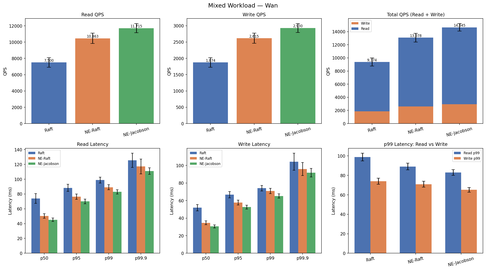
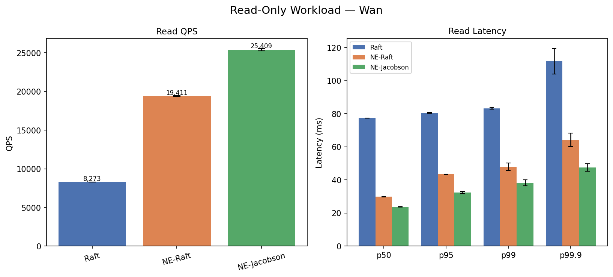
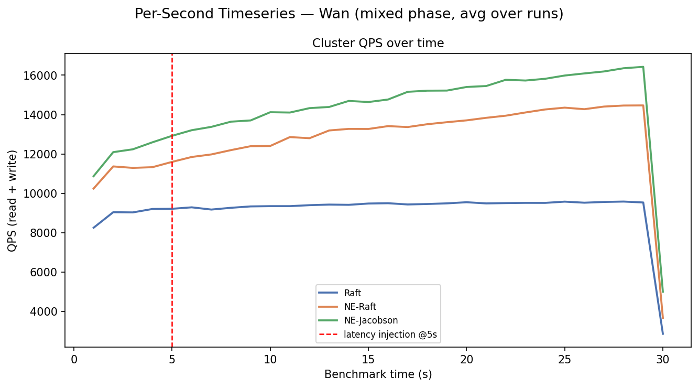

## WAN latency (petition_direct_election=true)

_fault=wan, 3 groups — runs 1..20 (20 selected)_

### Throughput & latency (trimmed mean)

#### WAN latency (petition_direct_election=true) | MIXED — READ (trimmed mean ±std)

```text
Group                             n          QPS                p50            p95            p99           p99.9        ok%  
------------------------------  ---  --------------------  -------------  -------------  -------------  -------------  -------
raft-wan-pde                     18       7,805 ±415        70.27 ±4.47    86.09 ±3.20    96.66 ±3.09   125.51 ±8.25   100.00 
netelect-raft-wan-pde            18      11,209 ±608        47.25 ±2.55    72.53 ±3.15    85.32 ±2.86   112.45 ±6.20   100.00 
netelect-jacobson-wan-pde        18      10,964 ±817        48.39 ±3.58    73.63 ±4.49    86.63 ±5.09   131.10 ±55.25   99.98 
```

#### WAN latency (petition_direct_election=true) | MIXED — WRITE (trimmed mean ±std)

```text
Group                             n          QPS                p50            p95            p99           p99.9        ok%  
------------------------------  ---  --------------------  -------------  -------------  -------------  -------------  -------
raft-wan-pde                     18       1,951 ±104        49.97 ±2.40    65.03 ±2.38    73.23 ±1.94   104.84 ±6.70   100.00 
netelect-raft-wan-pde            18       2,806 ±149        32.28 ±2.07    54.44 ±2.62    66.90 ±2.90    92.99 ±5.57   100.00 
netelect-jacobson-wan-pde        18       2,737 ±207        33.05 ±2.60    55.51 ±3.33    68.75 ±4.18   108.30 ±44.42   99.98 
```

#### WAN latency (petition_direct_election=true) | READ — READ (trimmed mean ±std)

```text
Group                             n          QPS                p50            p95            p99           p99.9        ok%  
------------------------------  ---  --------------------  -------------  -------------  -------------  -------------  -------
raft-wan-pde                     18        9,499 ±7         67.30 ±0.03    70.98 ±0.31    73.80 ±0.55   100.13 ±6.85   100.00 
netelect-raft-wan-pde            18       19,072 ±24        31.83 ±0.05    40.69 ±0.29    49.93 ±1.65    64.77 ±6.18   100.00 
netelect-jacobson-wan-pde        18       15,555 ±63        39.72 ±0.04    54.17 ±1.69    60.86 ±0.37    81.35 ±6.07   100.00 
```

#### Stability — cluster QPS, raw/untrimmed distribution

Trimmed tables above drop the best+worst run; this one keeps every run so high variance / bad-run tails (e.g. election-storm runs) stay visible. CV = std/mean (lower = more stable).

```text
Group                     phase         n       mean      std    CV%        min     median        max
-----------------------------------------------------------------------------------------------------
raft-wan-pde              mixed-read   20      7,781      478    6.1      6,692      7,932      8,444
raft-wan-pde              mixed-write  20      1,945      119    6.1      1,676      1,982      2,108
raft-wan-pde              read         20      9,500        9    0.1      9,484      9,499      9,523
netelect-raft-wan-pde     mixed-read   20     10,976    1,373   12.5      5,589     11,231     12,166
netelect-raft-wan-pde     mixed-write  20      2,749      342   12.4      1,405      2,817      3,059
netelect-raft-wan-pde     read         20     19,074       31    0.2     19,021     19,070     19,157
netelect-jacobson-wan-pde mixed-read   20     10,945      901    8.2      9,220     11,174     12,323
netelect-jacobson-wan-pde mixed-write  20      2,733      228    8.3      2,307      2,797      3,085
netelect-jacobson-wan-pde read         20     15,555       71    0.5     15,423     15,551     15,680
```

### Petition / leadership — fault=wan (from mixed-phase server logs)

Column meanings:

- **n** — runs analyzed for this group.
- **migrate%** — share of runs whose *final* leader is a near (non-far) node, i.e. leadership successfully migrated off the slow far leader. 100% = always ended on a fast node.
- **mig_t(s)** — approx benchmark-second at which read QPS rises from the slow-far-leader plateau to the fast-near-leader plateau (read from the per-second timeseries, since petition logs carry no wall-clock). Lower = migration took effect sooner. `n/a` = no clear rise.
- **LE/run** — average `[leader_elected]` events per run = number of leadership changes. Higher = more churn (extra re-elections / split votes).
- **pSend/run** — average `[petition_send]` per run: how many petitions followers sent toward a proposed faster leader.
- **pAcc/run** — average `[petition_accept]` per run: how many petitions a proposed leader accepted (majority petitioned *and* its RTT was no worse) → it then forces the old leader down.
- **nearPetn%** — share of runs in which at least one *near* node sent a petition. Confirms the fast nodes (not just far ones) actually drive the migration.
- **eMsgSent/run · eMsgRecv/run** — average cumulative `Raft.RequestVote` messages sent / received per run (election control-plane traffic). Lower = fewer/cleaner elections.

```text
Group                     n migrate% mig_t(s)  LE/run pSend/run pAcc/run nearPetn% eMsgSent/run eMsgRecv/run
------------------------------------------------------------------------------------------------------------
raft-wan-pde             20       0%      1.0     1.0         0      0.0        0%            4            4
netelect-raft-wan-pde    20      95%      4.9     1.9        90      0.9       95%            9            9
netelect-jacobson-wan-pde 20     100%      2.6     2.5         6      1.5       85%           18           17
```

**[netelect-raft-wan-pde] per-node election by quality (fastest→slowest):**

_node = node id; avg_out(ms) = injected outbound delay (network quality, lower = faster); elected = total `[leader_elected]` wins; share% = its fraction of all wins; final_leader× = runs that ended with this node as leader. Wins should concentrate on the fast (low-out) nodes._

```text
node   avg_out(ms)  elected  share% final_leader×
n2              14        9     23%             9
n4              15        5     13%             5
n3              15        5     13%             5
n0              36       20     51%             1
n1              36        0      0%             0
```

**[netelect-jacobson-wan-pde] per-node election by quality (fastest→slowest):**

_node = node id; avg_out(ms) = injected outbound delay (network quality, lower = faster); elected = total `[leader_elected]` wins; share% = its fraction of all wins; final_leader× = runs that ended with this node as leader. Wins should concentrate on the fast (low-out) nodes._

```text
node   avg_out(ms)  elected  share% final_leader×
n4              15       12     24%             9
n3              15        7     14%             5
n2              16       10     20%             6
n0              35       19     37%             0
n1              35        3      6%             0
```

### Plots

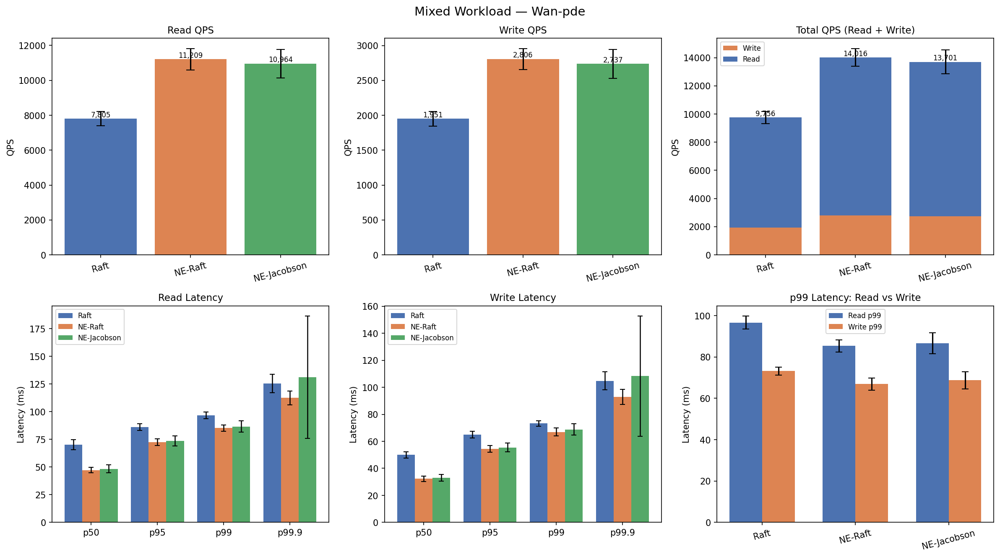
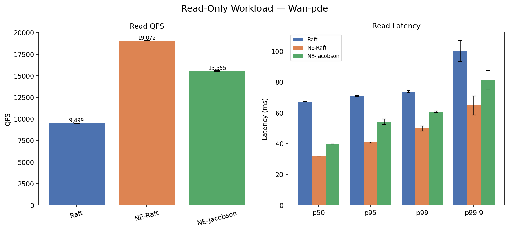
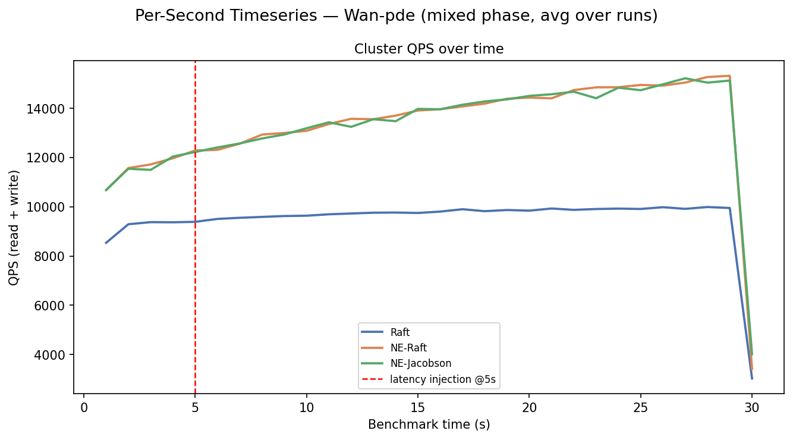

## Leader-crash recovery (petition disabled, rank-biased timeout)

_fault=failure, 3 groups — runs 1..20 (20 selected)_

### Throughput & latency (trimmed mean)

#### Leader-crash recovery (petition disabled, rank-biased timeout) | MIXED — READ (trimmed mean ±std)

```text
Group                             n          QPS                p50            p95            p99           p99.9        ok%  
------------------------------  ---  --------------------  -------------  -------------  -------------  -------------  -------
raft-failure                     18      13,213 ±836        39.26 ±2.55    64.06 ±3.06    79.04 ±5.38   156.92 ±32.75   99.52 
netelect-raft-failure            18      12,063 ±635        42.29 ±1.96    74.51 ±5.63    88.54 ±6.80   162.92 ±40.07   99.46 
netelect-jacobson-failure        18      14,062 ±297        37.13 ±0.67    62.12 ±1.26    75.60 ±1.96   156.65 ±34.29   99.56 
```

#### Leader-crash recovery (petition disabled, rank-biased timeout) | MIXED — WRITE (trimmed mean ±std)

```text
Group                             n          QPS                p50            p95            p99           p99.9        ok%  
------------------------------  ---  --------------------  -------------  -------------  -------------  -------------  -------
raft-failure                     18       3,305 ±210        24.49 ±2.65    45.49 ±3.17    57.56 ±3.51   191.03 ±23.18   99.81 
netelect-raft-failure            18       3,021 ±155        25.97 ±2.33    52.26 ±4.30    69.21 ±6.39   157.83 ±43.21   99.76 
netelect-jacobson-failure        18       3,514 ±72         21.09 ±0.71    41.64 ±1.26    53.98 ±2.14   176.38 ±33.57   99.81 
```

#### Leader-crash recovery (petition disabled, rank-biased timeout) | READ — READ (trimmed mean ±std)

```text
Group                             n          QPS                p50            p95            p99           p99.9        ok%  
------------------------------  ---  --------------------  -------------  -------------  -------------  -------------  -------
raft-failure                     18     31,889 ±6,498       16.48 ±3.54    46.00 ±8.13    49.38 ±5.22   60.56 ±12.56    99.73 
netelect-raft-failure            18     35,603 ±5,029       14.24 ±2.26   43.30 ±13.99   55.34 ±18.47   64.63 ±20.55    99.81 
netelect-jacobson-failure        18     51,796 ±1,637       12.38 ±0.42    19.17 ±0.44    24.13 ±0.24    31.47 ±0.84    99.88 
```

#### Stability — cluster QPS, raw/untrimmed distribution

Trimmed tables above drop the best+worst run; this one keeps every run so high variance / bad-run tails (e.g. election-storm runs) stay visible. CV = std/mean (lower = more stable).

```text
Group                     phase         n       mean      std    CV%        min     median        max
-----------------------------------------------------------------------------------------------------
raft-failure              mixed-read   20     13,194      985    7.5     11,085     13,230     14,952
raft-failure              mixed-write  20      3,300      248    7.5      2,768      3,309      3,739
raft-failure              read         20     32,210    7,369   22.9     21,868     31,702     48,317
netelect-raft-failure     mixed-read   20     12,061      812    6.7     10,259     11,948     13,813
netelect-raft-failure     mixed-write  20      3,019      200    6.6      2,562      3,000      3,449
netelect-raft-failure     read         20     35,354    6,226   17.6     20,184     36,335     46,031
netelect-jacobson-failure mixed-read   20     14,051      338    2.4     13,342     14,016     14,578
netelect-jacobson-failure mixed-write  20      3,512       81    2.3      3,341      3,504      3,639
netelect-jacobson-failure read         20     51,906    1,810    3.5     49,918     51,094     55,880
```

### Failure recovery — fault=failure (leader crash → re-election, mixed-phase logs)

Recurring failover: each leader steps down ~N s after winning, so every re-election is a recovery event; metrics pool ALL events across runs (ev = total events). detect = last heartbeat → candidate; recovery = detect + (candidate → won), winner's single clock. **Recovery is reported as a distribution (med / p95 / max), not just mean — a single election-storm run can blow up the mean while the median stays normal.**

```text
Group                     ev crash/run winNear%  rec_med  rec_p95  rec_max  rec_std  det_med  det_max eMsg/run
--------------------------------------------------------------------------------------------------------------
raft-failure             121       6.0      76%      193      240     7327      646      181     7320       39
netelect-raft-failure    120       6.0      75%      197      256      322       29      183      322       36
netelect-jacobson-failure 124       6.2     100%      198      229      243       23      195      238       29
```

#### Recovery winners by node (recovery events only)

Where leadership lands AFTER a crash (the initial pinned election is excluded). fastest% / 2nd% = share won by the lowest- and second-lowest-latency node.

```text
Group                     fastest fast win%   2nd  2nd win%  two-fastest%
-------------------------------------------------------------------------
raft-failure              n2(0ms)       34%    n3       21%           55%
netelect-raft-failure     n2(0ms)       33%    n3       22%           56%
netelect-jacobson-failure  n2(0ms)       56%    n3       43%           99%
```

**[raft-failure] recovery winners by node (fastest→slowest):**

```text
node    out(ms)  recov_wins    win%  final×
n2            0          41     34%       5
n3            5          25     21%       4
n4           10          26     21%       4
n0           20          17     14%       4
n1           25          12     10%       3
```

**[netelect-raft-failure] recovery winners by node (fastest→slowest):**

```text
node    out(ms)  recov_wins    win%  final×
n2            0          40     33%      10
n3            5          27     22%       4
n4           10          23     19%       4
n0           20          17     14%       1
n1           25          13     11%       1
```

**[netelect-jacobson-failure] recovery winners by node (fastest→slowest):**

```text
node    out(ms)  recov_wins    win%  final×
n2            0          70     56%       8
n3            5          53     43%      12
n4           10           1      1%       0
n0           20           0      0%       0
n1           25           0      0%       0
```

### Plots

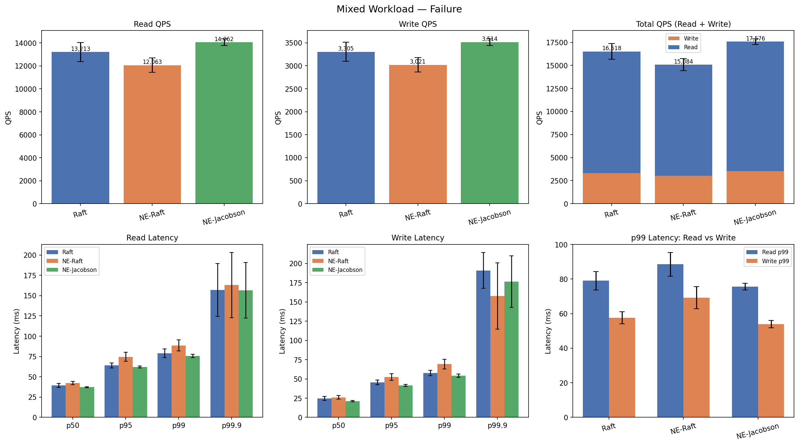
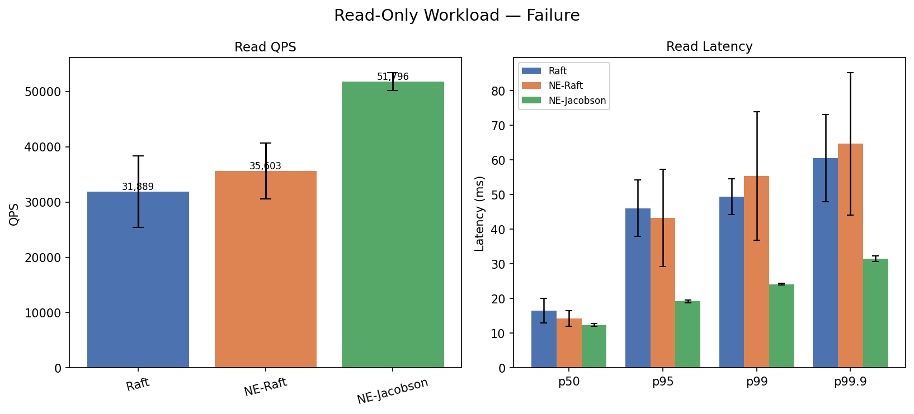
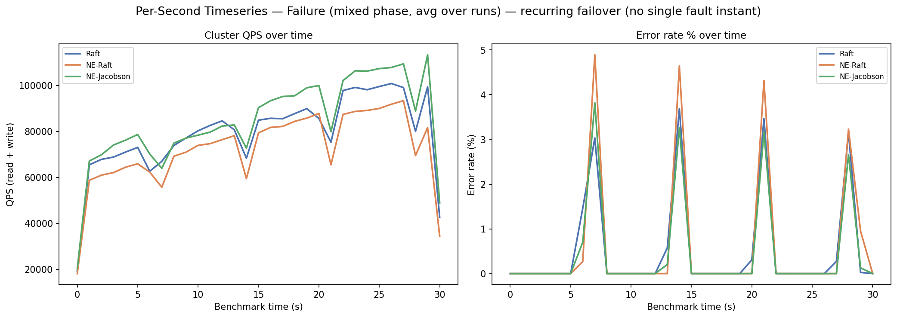

## Cross-dataset comparison

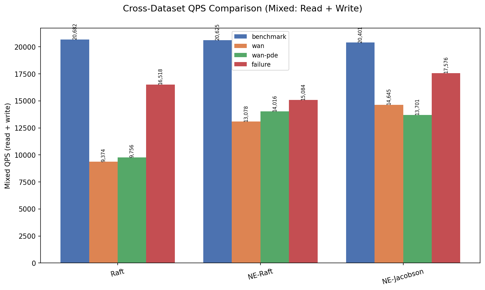
